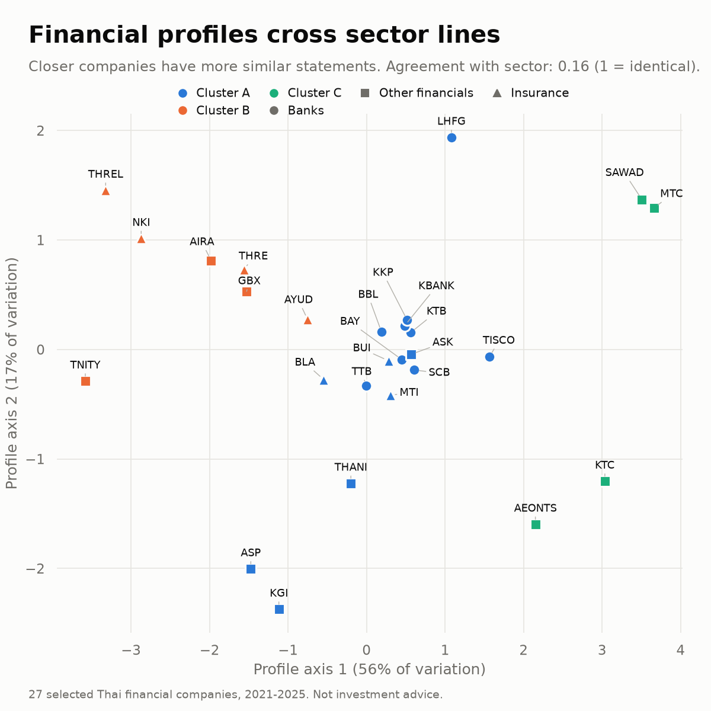
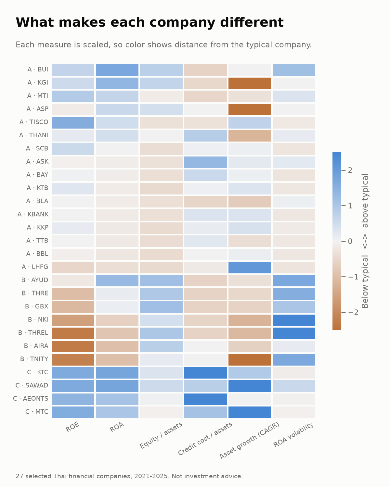
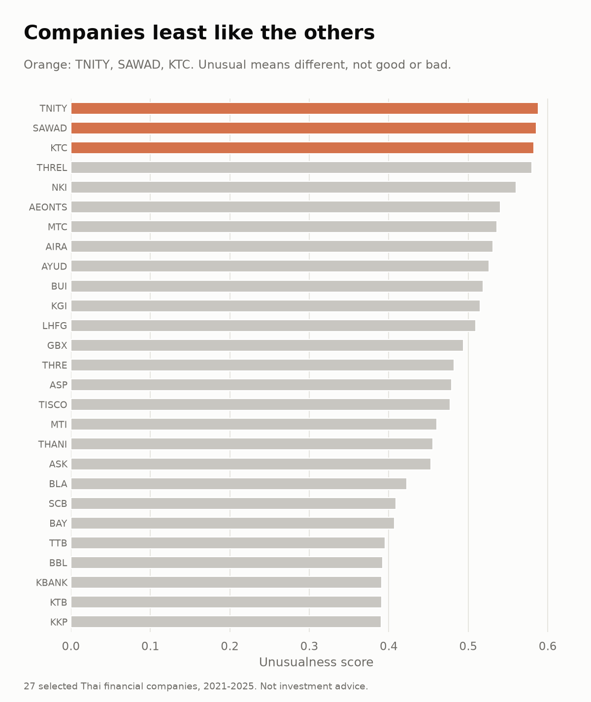
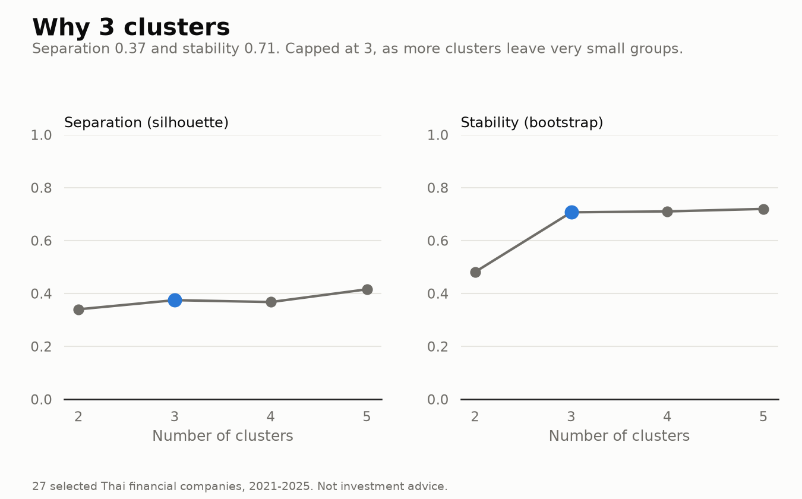

# Financial Peer Groups in Thai Finance

> [!WARNING]
> **For learning only.** This is a personal study and portfolio project. It is not used commercially, is not investment advice, and is not intended to harm, defame or judge any company or person. Groups and scores describe similarities in reported figures only and say nothing about a company's quality or prospects. The financial statements belong to their respective companies and sources.
>
> **เพื่อการศึกษาเท่านั้น** โปรเจกต์นี้จัดทำเพื่อการศึกษาและเป็นผลงานส่วนตัว ไม่ได้ใช้ในเชิงพาณิชย์ ไม่ใช่คำแนะนำการลงทุน และไม่มีเจตนาทำให้บริษัทหรือบุคคลใดเสียหาย กลุ่มและคะแนนในโปรเจกต์นี้บอกเพียงความคล้ายกันของตัวเลขในงบ ไม่ได้ประเมินคุณภาพหรือแนวโน้มของบริษัท ข้อมูลงบการเงินเป็นของบริษัทและแหล่งข้อมูลต้นทาง

**What:** Groups 27 Thai financial companies by what their financial statements look like, and finds the companies least like the others.

**Why:** Banks, insurers and other financial companies are usually compared within their own business type. Business type says what a company does, not whether its statements behave alike. This project tests how well business type matches statement profile, so that peer comparisons rest on the numbers.

**Built with:** pandas, NumPy, scikit-learn (K-means, PCA, Isolation Forest), Matplotlib and Seaborn.

**Key findings**
- The 27 companies form three groups, and the groups match business type only weakly (adjusted Rand index 0.16, where 1 means identical).
- All nine banks land in one group, while insurers and other financial companies split across all three.
- TNITY, SAWAD and KTC are the least like the rest.

## Data

| Item | Detail |
|---|---|
| Companies | 27 selected Thai financial companies: 9 banks, 7 insurers and 11 other financial companies |
| Period | Annual statements, 2021-2025 |
| Source files | 27 Excel workbooks in [data/workbooks](data/workbooks), one per company, each with balance sheet, income and cash flow sheets |
| Model input | [company_panel.csv](company_panel.csv): one row per company and year with ROE, ROA, equity to assets, credit cost to average assets and total assets, calculated from the workbooks |

ROE, ROA and credit cost use the average of the opening and closing balance, so they start in 2022.

## Methodology

**1. Profile each company (pandas).** Five years become one row of six measures.

| Measure | Calculation | What it describes |
|---|---|---|
| ROE | Median of net profit / average equity | Return to shareholders |
| ROA | Median of net profit / average assets | Return on the whole balance sheet |
| Equity / assets | Median of equity / assets | Capital cushion; lower means more leverage |
| Credit cost / assets | Median of expected credit loss / average assets | Cost of bad loans |
| Asset growth (CAGR) | (2025 assets / 2021 assets)^(1/4) - 1 | Growth of the business |
| ROA volatility | Standard deviation of yearly ROA | How steady profits are |

Medians are used so that one unusual year does not distort the profile.

**2. Prepare for the model (NumPy and scikit-learn).** The one missing value (credit cost for one company) is filled with the median. Values are capped at the 5th and 95th percentiles so that one extreme company cannot dominate, then scaled with `RobustScaler` so that every measure counts equally.

**3. Group the companies (scikit-learn `KMeans`).** K-means is run for 2 to 5 groups. Each option is scored on separation (silhouette score) and on stability, measured by refitting on 100 bootstrap samples and comparing the groups with the original (adjusted Rand index). Three groups are kept.

**4. Draw the map (scikit-learn `PCA`).** Principal component analysis reduces the six measures to the two axes that keep the most variation, so that all companies fit on one chart.

**5. Find unusual companies (scikit-learn `IsolationForest`).** Isolation Forest scores how easily each company can be separated from the rest, and flags the top 10%.

**6. Report (Matplotlib and Seaborn).** The script saves four PNG charts, an HTML dashboard and a CSV of results.

## Results

### 1. Company map



**What it shows:** Each point is a company. Companies close together have similar statements. Color is the group found by the model, and shape is the business type.

**How to read it:** The horizontal axis holds 56% of the variation between companies and the vertical axis 17%. Each axis combines the six measures, so positions matter only relative to other companies.

**What it means:** If business type explained the statements, each shape would form its own cluster. Instead, the banks (circles) sit together near the middle, while insurers (triangles) and other financial companies (squares) appear in every group.

### 2. Profile heatmap



**What it shows:** One row per company, sorted by group, and one column per measure. Blue is above the typical company and orange is below; the darker the color, the larger the gap.

**What it means:** It shows why each company landed in its group.

| Group | Compared with all companies | Members |
|---|---|---|
| A (16) | Lower equity to assets, steadier ROA | All 9 banks, ASK, ASP, BLA, BUI, KGI, MTI, THANI |
| B (7) | More volatile ROA, lower ROE | AIRA, AYUD, GBX, NKI, THRE, THREL, TNITY |
| C (4) | Faster asset growth, higher credit cost | AEONTS, KTC, MTC, SAWAD |

- **Group A, steady profits:** Median ROE is 8.9% and ROA barely moves from year to year. The banks bring the group's equity to assets down, although some members, such as the insurers, hold more capital.
- **Group B, uneven profits:** ROA swings the most and median ROE is close to zero (0.2%). Four of the seven are insurers.
- **Group C, fast-growing consumer lenders:** Median assets grew 11.8% a year and credit cost is the highest, which fits lending to individuals. Median ROE is 17.0%, the highest of the three groups.

### 3. Unusual companies



**What it shows:** The Isolation Forest score for every company. A higher score means the company is easier to separate from the rest. Orange marks the three flagged companies.

**What it means:** These three have combinations of measures that no other company shares:
- **SAWAD:** Assets grew 21.2% a year, the fastest in the set, with ROE of 17.1%.
- **KTC:** Credit cost of 5.4% of assets, the highest in the set, together with ROE of 20.7%.
- **TNITY:** Negative ROE (-2.9%), with assets shrinking 11.3% a year.

Unusual means different, not better or worse. These are the companies to check first, for a real business difference or for a data issue.

### 4. Why three groups



**What it shows:** The silhouette score (how clearly the groups separate) and the bootstrap stability (how often the same groups return on resampled data) for 2 to 5 groups. Blue marks the chosen option.

**What it means:** Moving from two to three groups raises stability from 0.48 to 0.71, so three groups are far more repeatable. Five groups score slightly higher on silhouette (0.42 against 0.37), but leave two groups with only two companies, which is too few to describe, and five colors cannot be told apart reliably by color-blind readers. A silhouette of 0.37 means the groups are real but overlap, so companies near a boundary could change group.

## Outputs

| File | Contents |
|---|---|
| [output/01_company_map.png](output/01_company_map.png) | Company map |
| [output/02_profile_heatmap.png](output/02_profile_heatmap.png) | Profile heatmap |
| [output/03_unusual_companies.png](output/03_unusual_companies.png) | Unusual companies |
| [output/04_cluster_check.png](output/04_cluster_check.png) | Cluster check |
| [output/dashboard.html](output/dashboard.html) | All charts, group cards and the company table on one page. Download it and open it in a browser |
| [output/companies.csv](output/companies.csv) | Measures, group, map position and unusualness score for each company |
| [docs/Financial_Peer_Groups_Explained.docx](docs/Financial_Peer_Groups_Explained.docx) | The same explanation in Thai |

## Run it

```bash
pip install -r requirements.txt
python peer_analysis.py --open
```

The script reads `company_panel.csv`, writes everything to `output/` (replacing earlier results) and, with `--open`, opens the dashboard.

## Data sources

Amounts are in thousand baht. 26 workbooks use the SET statement export layout. The SCB workbook uses a bilingual layout and holds the statements of Siam Commercial Bank, not those of its listed parent SCBX. Each company's statements can also be checked on the Stock Exchange of Thailand (SET) and the Thai SEC.

| Company | Group | Workbook | SET page | SEC filings |
|---|---|---|---|---|
| BAY | Bank | [FinancialStatement BAY 2021-2025.xlsx](data/workbooks/FinancialStatement%20BAY%202021-2025.xlsx) | [SET](https://www.set.or.th/en/market/product/stock/quote/BAY/financial-statement/company-highlights) | [SEC filings](https://market.sec.or.th/public/idisc/en/viewmore/fs-full?searchSymbol=BAY) |
| BBL | Bank | [FinancialStatement BBL 2021-2025.xlsx](data/workbooks/FinancialStatement%20BBL%202021-2025.xlsx) | [SET](https://www.set.or.th/en/market/product/stock/quote/BBL/financial-statement/company-highlights) | [SEC filings](https://market.sec.or.th/public/idisc/en/viewmore/fs-full?searchSymbol=BBL) |
| KBANK | Bank | [FinancialStatement Kbank 2021-2025.xlsx](data/workbooks/FinancialStatement%20Kbank%202021-2025.xlsx) | [SET](https://www.set.or.th/en/market/product/stock/quote/KBANK/financial-statement/company-highlights) | [SEC filings](https://market.sec.or.th/public/idisc/en/viewmore/fs-full?searchSymbol=KBANK) |
| KKP | Bank | [FinancialStatement KKP 2021-2025.xlsx](data/workbooks/FinancialStatement%20KKP%202021-2025.xlsx) | [SET](https://www.set.or.th/en/market/product/stock/quote/KKP/financial-statement/company-highlights) | [SEC filings](https://market.sec.or.th/public/idisc/en/viewmore/fs-full?searchSymbol=KKP) |
| KTB | Bank | [FinancialStatement KTB 2021-2025.xlsx](data/workbooks/FinancialStatement%20KTB%202021-2025.xlsx) | [SET](https://www.set.or.th/en/market/product/stock/quote/KTB/financial-statement/company-highlights) | [SEC filings](https://market.sec.or.th/public/idisc/en/viewmore/fs-full?searchSymbol=KTB) |
| LHFG | Bank | [FinancialStatement LHFG 2021-2025.xlsx](data/workbooks/FinancialStatement%20LHFG%202021-2025.xlsx) | [SET](https://www.set.or.th/en/market/product/stock/quote/LHFG/financial-statement/company-highlights) | [SEC filings](https://market.sec.or.th/public/idisc/en/viewmore/fs-full?searchSymbol=LHFG) |
| SCB | Bank | [FinancialStatement SCB 2021-2025.xlsx](data/workbooks/FinancialStatement%20SCB%202021-2025.xlsx) | [SET](https://www.set.or.th/en/market/product/stock/quote/SCB/financial-statement/company-highlights) | [SEC filings](https://market.sec.or.th/public/idisc/en/viewmore/fs-full?searchSymbol=SCB) |
| TISCO | Bank | [FinancialStatement TISCO 2021-2025.xlsx](data/workbooks/FinancialStatement%20TISCO%202021-2025.xlsx) | [SET](https://www.set.or.th/en/market/product/stock/quote/TISCO/financial-statement/company-highlights) | [SEC filings](https://market.sec.or.th/public/idisc/en/viewmore/fs-full?searchSymbol=TISCO) |
| TTB | Bank | [FinancialStatement TTB 2021-2025.xlsx](data/workbooks/FinancialStatement%20TTB%202021-2025.xlsx) | [SET](https://www.set.or.th/en/market/product/stock/quote/TTB/financial-statement/company-highlights) | [SEC filings](https://market.sec.or.th/public/idisc/en/viewmore/fs-full?searchSymbol=TTB) |
| AEONTS | Other financials | [FinancialStatement AEONTS 2021-2025.xlsx](data/workbooks/FinancialStatement%20AEONTS%202021-2025.xlsx) | [SET](https://www.set.or.th/en/market/product/stock/quote/AEONTS/financial-statement/company-highlights) | [SEC filings](https://market.sec.or.th/public/idisc/en/viewmore/fs-full?searchSymbol=AEONTS) |
| AIRA | Other financials | [FinancialStatement AIRA 2021-2025.xlsx](data/workbooks/FinancialStatement%20AIRA%202021-2025.xlsx) | [SET](https://www.set.or.th/en/market/product/stock/quote/AIRA/financial-statement/company-highlights) | [SEC filings](https://market.sec.or.th/public/idisc/en/viewmore/fs-full?searchSymbol=AIRA) |
| ASK | Other financials | [FinancialStatement ASK 2021-2025.xlsx](data/workbooks/FinancialStatement%20ASK%202021-2025.xlsx) | [SET](https://www.set.or.th/en/market/product/stock/quote/ASK/financial-statement/company-highlights) | [SEC filings](https://market.sec.or.th/public/idisc/en/viewmore/fs-full?searchSymbol=ASK) |
| ASP | Other financials | [FinancialStatement ASP 2021-2025.xlsx](data/workbooks/FinancialStatement%20ASP%202021-2025.xlsx) | [SET](https://www.set.or.th/en/market/product/stock/quote/ASP/financial-statement/company-highlights) | [SEC filings](https://market.sec.or.th/public/idisc/en/viewmore/fs-full?searchSymbol=ASP) |
| GBX | Other financials | [FinancialStatement GBX 2021-2025.xlsx](data/workbooks/FinancialStatement%20GBX%202021-2025.xlsx) | [SET](https://www.set.or.th/en/market/product/stock/quote/GBX/financial-statement/company-highlights) | [SEC filings](https://market.sec.or.th/public/idisc/en/viewmore/fs-full?searchSymbol=GBX) |
| KGI | Other financials | [FinancialStatement KGI 2021-2025.xlsx](data/workbooks/FinancialStatement%20KGI%202021-2025.xlsx) | [SET](https://www.set.or.th/en/market/product/stock/quote/KGI/financial-statement/company-highlights) | [SEC filings](https://market.sec.or.th/public/idisc/en/viewmore/fs-full?searchSymbol=KGI) |
| KTC | Other financials | [FinancialStatement KTC 2021-2025.xlsx](data/workbooks/FinancialStatement%20KTC%202021-2025.xlsx) | [SET](https://www.set.or.th/en/market/product/stock/quote/KTC/financial-statement/company-highlights) | [SEC filings](https://market.sec.or.th/public/idisc/en/viewmore/fs-full?searchSymbol=KTC) |
| MTC | Other financials | [FinancialStatement MTC 2021-2025.xlsx](data/workbooks/FinancialStatement%20MTC%202021-2025.xlsx) | [SET](https://www.set.or.th/en/market/product/stock/quote/MTC/financial-statement/company-highlights) | [SEC filings](https://market.sec.or.th/public/idisc/en/viewmore/fs-full?searchSymbol=MTC) |
| SAWAD | Other financials | [FinancialStatement SAWAD 2021-2025.xlsx](data/workbooks/FinancialStatement%20SAWAD%202021-2025.xlsx) | [SET](https://www.set.or.th/en/market/product/stock/quote/SAWAD/financial-statement/company-highlights) | [SEC filings](https://market.sec.or.th/public/idisc/en/viewmore/fs-full?searchSymbol=SAWAD) |
| THANI | Other financials | [FinancialStatement THANI 2021-2025.xlsx](data/workbooks/FinancialStatement%20THANI%202021-2025.xlsx) | [SET](https://www.set.or.th/en/market/product/stock/quote/THANI/financial-statement/company-highlights) | [SEC filings](https://market.sec.or.th/public/idisc/en/viewmore/fs-full?searchSymbol=THANI) |
| TNITY | Other financials | [FinancialStatement TNITY 2021-2025.xlsx](data/workbooks/FinancialStatement%20TNITY%202021-2025.xlsx) | [SET](https://www.set.or.th/en/market/product/stock/quote/TNITY/financial-statement/company-highlights) | [SEC filings](https://market.sec.or.th/public/idisc/en/viewmore/fs-full?searchSymbol=TNITY) |
| AYUD | Insurance | [FinancialStatement AYUD 2021-2025.xlsx](data/workbooks/FinancialStatement%20AYUD%202021-2025.xlsx) | [SET](https://www.set.or.th/en/market/product/stock/quote/AYUD/financial-statement/company-highlights) | [SEC filings](https://market.sec.or.th/public/idisc/en/viewmore/fs-full?searchSymbol=AYUD) |
| BLA | Insurance | [FinancialStatement BLA 2021-2025.xlsx](data/workbooks/FinancialStatement%20BLA%202021-2025.xlsx) | [SET](https://www.set.or.th/en/market/product/stock/quote/BLA/financial-statement/company-highlights) | [SEC filings](https://market.sec.or.th/public/idisc/en/viewmore/fs-full?searchSymbol=BLA) |
| BUI | Insurance | [FinancialStatement BUI 2021-2025.xlsx](data/workbooks/FinancialStatement%20BUI%202021-2025.xlsx) | [SET](https://www.set.or.th/en/market/product/stock/quote/BUI/financial-statement/company-highlights) | [SEC filings](https://market.sec.or.th/public/idisc/en/viewmore/fs-full?searchSymbol=BUI) |
| MTI | Insurance | [FinancialStatement MTI 2021-2025.xlsx](data/workbooks/FinancialStatement%20MTI%202021-2025.xlsx) | [SET](https://www.set.or.th/en/market/product/stock/quote/MTI/financial-statement/company-highlights) | [SEC filings](https://market.sec.or.th/public/idisc/en/viewmore/fs-full?searchSymbol=MTI) |
| NKI | Insurance | [FinancialStatement NKI 2021-2025.xlsx](data/workbooks/FinancialStatement%20NKI%202021-2025.xlsx) | [SET](https://www.set.or.th/en/market/product/stock/quote/NKI/financial-statement/company-highlights) | [SEC filings](https://market.sec.or.th/public/idisc/en/viewmore/fs-full?searchSymbol=NKI) |
| THRE | Insurance | [FinancialStatement THRE 2021-2025.xlsx](data/workbooks/FinancialStatement%20THRE%202021-2025.xlsx) | [SET](https://www.set.or.th/en/market/product/stock/quote/THRE/financial-statement/company-highlights) | [SEC filings](https://market.sec.or.th/public/idisc/en/viewmore/fs-full?searchSymbol=THRE) |
| THREL | Insurance | [FinancialStatement THREL 2021-2025.xlsx](data/workbooks/FinancialStatement%20THREL%202021-2025.xlsx) | [SET](https://www.set.or.th/en/market/product/stock/quote/THREL/financial-statement/company-highlights) | [SEC filings](https://market.sec.or.th/public/idisc/en/viewmore/fs-full?searchSymbol=THREL) |

Filings used to check specific figures:
- [Kasikornbank audited statements, 2025](https://www.kasikornbank.com/en/IR/FinanInfoReports/financialReports/4Q25_audited-en.pdf): restated 2024 totals
- [Allianz Ayudhya Capital 56-1 One Report, 2025](https://ayud.azay.co.th/content/dam/onemarketing/azay/ayud-azay-co-th/investor-relations-information/annual-registration-statement-56-1/2568/2025-56-1-One-report-EN.pdf): reclassification of 2024 cash
- [Bank of Ayudhya reviewed statements, Q1 2025](https://www.krungsri.com/getmedia/541fcbaa-4a6e-459c-9813-1a7578a577e8/ir-financial-statement-mar2025-reviewed-en): 2024 cash figures

## Limitations

- The 27 companies are a selection, so the results do not describe the whole Thai market.
- With 27 companies, each group rests on few data points. The groups describe similarity in reported figures and are not a rating.
- Some insurers report on the equity method, and some 2024 figures were later restated by the companies, which affects comparison.
- Figures have been checked against filings only for KBANK, AYUD and BAY.
- Data redistribution terms have not been checked. Keep this repository private until they are.

This project is for learning only. It is not used commercially, is not investment advice, and is not intended to harm any company or person.
